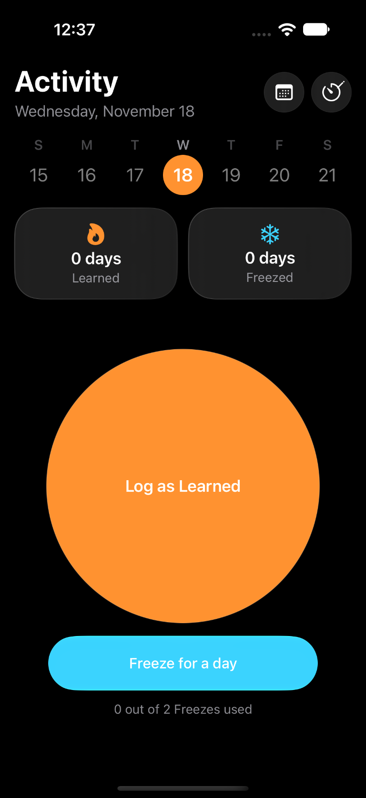

# LearningApp

<p align="center">
  
</p>

<p align="center">
  A focused iOS application for building consistent learning habits through daily progress, streaks, and scheduled learning goals.
</p>

<p align="center">
  
  
  
</p>

## Overview

LearningApp helps users turn learning into a consistent routine. Users define what they want to learn, choose a weekly, monthly, or yearly goal, and record completed learning sessions from the Activity screen.

Progress is stored locally on the device, allowing users to continue tracking their streak and activity after closing the app.

## Features

- Create and update a personal learning goal
- Choose a week, month, or year duration
- Log completed learning days
- Preserve streaks with limited freezed days
- Review activity across a full-year calendar
- View learned and freezed days with clear visual states
- Display a goal completion screen after reaching the target

## Screenshots

<table>
  <tr>
    <td align="center"><strong>Learning Goal</strong></td>
    <td align="center"><strong>Activity</strong></td>
    <td align="center"><strong>Calendar</strong></td>
  </tr>
  <tr>
    <td></td>
    <td></td>
    <td></td>
  </tr>
</table>

## Activity Rules

| Goal | Required learning days | Freezed days |
|---|---:|---:|
| Week | 7 | 2 |
| Month | 30 | 8 |
| Year | 365 | 96 |

A streak continues for up to 32 hours between learning or freezed actions.

## Technology

- Swift
- SwiftUI
- MVVM architecture
- `UserDefaults` for local persistence
- SF Symbols
- Native iOS navigation and sheets

## Project Structure

```text
LearningApp/
├── Models/
├── ViewModels/
├── Views/
│   └── Components/
└── Assets.xcassets/
```

## Getting Started

### Requirements

- macOS with Xcode 26 or later
- iOS 27 or later Simulator

### Installation

```bash
git clone https://github.com/bakosh2/LearningApp.git
cd LearningApp
xed LearningApp.xcodeproj
```

### Run the App

1. Open `LearningApp.xcodeproj` in Xcode.
2. Select the **LearningApp** scheme.
3. Choose an iPhone simulator.
4. Click **Run** or press `Cmd+R`.
