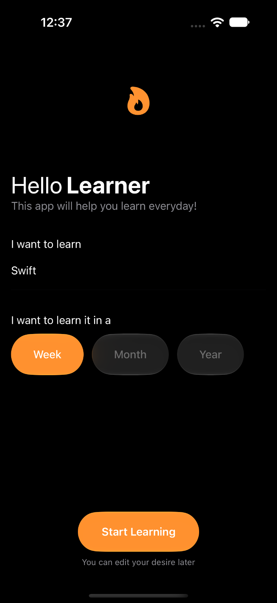
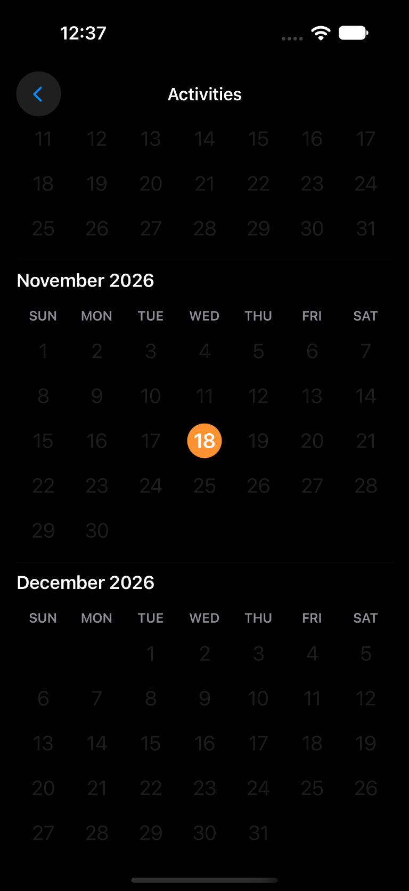

<div align="center">
  <span style="font-size:72px">🔥</span>

  # Learning App

  تطبيق iOS لمتابعة أهداف التعلم اليومية، إنشاء سلاسل متتالية، وإدارة أيام التعلم والتجميد.
</div>

## Screenshots

<p align="center">
  
  
  
</p>

## Features

- إنشاء هدف تعلم وتحديد المدة: أسبوع، شهر، أو سنة
- تسجيل يوم تعليمي والحفاظ على سلسلة التعلم
- تجميد الأيام وفق حدود الهدف
- تقويم شهري يعرض الأيام المسجلة والمجمدة
- حفظ التقدم على الجهاز
- واجهة SwiftUI داكنة بتأثيرات زجاجية

## Requirements

- macOS
- Xcode 26 أو أحدث
- iOS 27 Simulator

## Run

```bash
git clone https://github.com/bakosh2/LearningApp.git
cd LearningApp
xed LearningApp.xcodeproj
```

اختر مخطط **LearningApp** ثم جهاز iPhone من Xcode واضغط **Run**.
